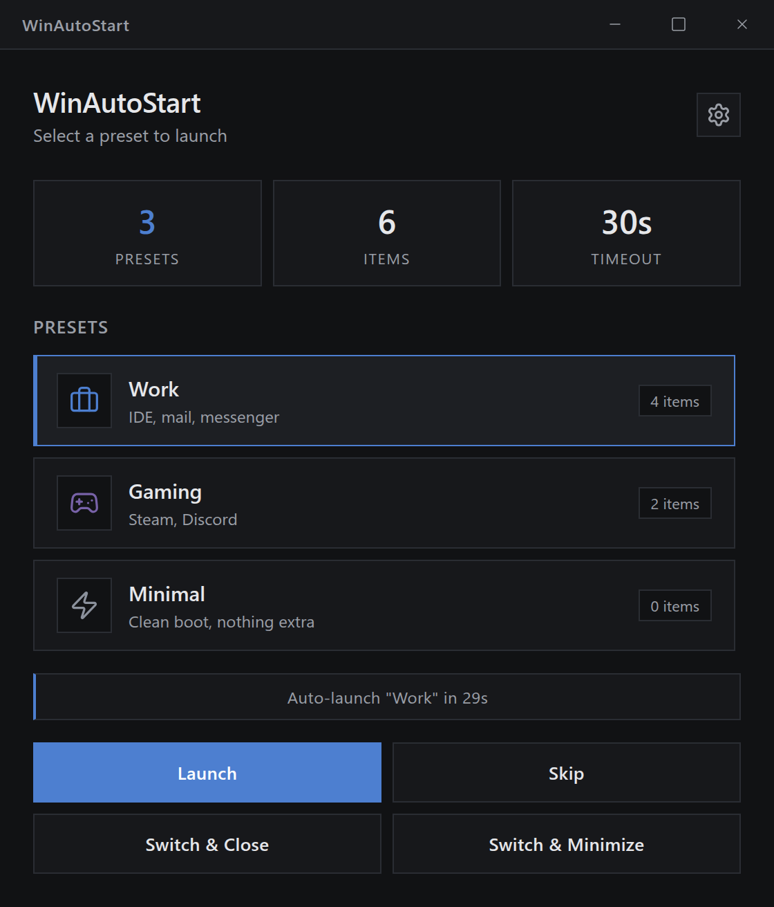
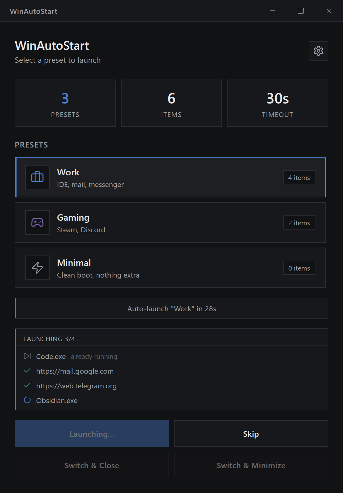
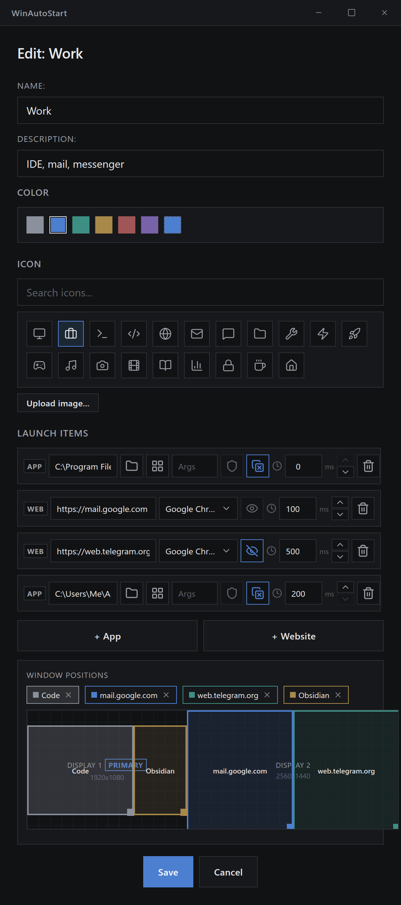
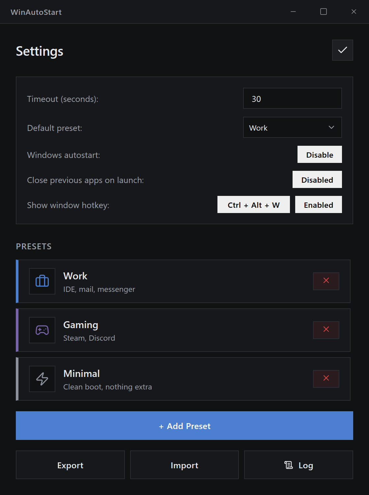

<p align="center">
  
</p>

<h1 align="center">WinAutoStart</h1>

<p align="center">
  Pick a preset of apps and websites to launch when Windows boots —<br>
  with per-item delays, window placement and a one-key switch between presets.
</p>

<p align="center">
  <a href="https://github.com/Saivelin/winautostart/actions/workflows/ci.yml"></a>
</p>

<table align="center">
  <tr>
    <td align="center" valign="top"><br><sub>Pick a preset — or let the countdown pick the default</sub></td>
    <td align="center" valign="top"><br><sub>Per-item progress while a preset launches</sub></td>
  </tr>
  <tr>
    <td align="center" valign="top"><br><sub>Preset editor with the window-placement map</sub></td>
    <td align="center" valign="top"><br><sub>Settings: countdown, autostart, hotkey, import/export</sub></td>
  </tr>
</table>

## Install

1. Download `WinAutoStart_x.y.z_x64-setup.exe` from the [latest release](https://github.com/Saivelin/winautostart/releases/latest) and run it. Windows 10/11 x64; WebView2 is installed by the setup if missing.
2. SmartScreen will say "Windows protected your PC" — the installers are not code-signed. Click **More info → Run anyway**. Prefer not to? [Build from source](#building-from-source); the release binaries are built by the public [Release workflow](.github/workflows/release.yml) from the tagged source, and every release ships a `SHA256SUMS.txt`.
3. On first run, say **Yes** to the autostart prompt (you can change it later in Settings).

The setup installs for the current user only (no admin rights, `%LOCALAPPDATA%\WinAutoStart`) and follows the system language (English or Russian). An `.msi` is attached to each release as well — see the [FAQ](#faq) for how uninstalling differs.

The app makes no network requests of its own: it only opens the websites you put into your presets.

## Quick start

1. Open **Settings → + Add Preset**, name it, pick a color and icon.
2. Add items with **+ App** (an `.exe`, `.lnk`, `.bat`/`.cmd` — browse, or pick from the Start Menu list) or **+ Website** (URL, browser, private mode). Set a delay per item if an app needs the previous one to settle.
3. Optionally click a monitor on the **Window Positions** map to place each app's window; drag to move, drag the corner to resize, double-click to fill the monitor.
4. Save, then set the preset as **Default preset** in Settings. On the next boot WinAutoStart counts down and launches it — click a preset (or open Settings) to stop the countdown and pick another one instead.

Switching during the day: the window is one `Ctrl+Alt+W` away (or a left-click on the tray icon), and the tray menu launches any preset directly.

## Features

- **Preset selector** — define named groups of apps/websites (e.g. "Work", "Gaming", "Minimal") with a color and icon, and pick which one runs at startup
- **App & website launching** — launch executables with arguments (optionally elevated via UAC), or open URLs in a specific browser with optional incognito/private mode
- **Window positioning** — place each launched app on a chosen monitor with exact position and size, edited visually on a monitor map
- **Configurable delays** — stagger launches with a per-item delay
- **Launch progress & error reporting** — a per-item status list streams in while a preset launches; failed items show the error instead of failing silently
- **Countdown timer** — auto-launches the default preset after a timeout, or exits if no default is set; selecting a preset or opening Settings stops the countdown
- **Switch modes** — "Switch & Close" asks the previous preset's apps to close (so unsaved work can be saved) and force-closes only what is still running 3s later; "Switch & Minimize" minimizes them instead
- **Already-running detection** — apps already running from the same executable path are skipped rather than launched twice; per item this can be switched off
- **System tray** — the window closes to tray; tray menu launches any preset directly; left-click reopens the window
- **Global hotkey** — `Ctrl+Alt+W` shows/focuses the window from anywhere; re-bindable in Settings (Ctrl or Alt required) or switchable off entirely
- **Single instance** — starting the app while it is already running (autostart at boot, then opened by hand) shows the running window instead of launching a second copy
- **Windows autostart** — registers itself in `HKCU\...\Run` on first-run prompt or from Settings (no admin needed)
- **Import/export** — presets can be exported to and imported from JSON files
- **Diagnostics log** — launch steps, positioning and errors are written to `%APPDATA%\WinAutoStart\log.txt` (rotated at 512 KB); Settings has a "Log" button that opens it
- **Custom title bar** — frameless window with drag, minimize, maximize, and close-to-tray

## FAQ

**Where are my presets stored?** In `%APPDATA%\WinAutoStart\config.json`; the format is documented [below](#configuration). Use **Settings → Export** for a backup you can import on another machine.

**Why does Windows warn about the installer?** It isn't code-signed (a certificate costs more than this project earns, which is nothing). The binaries come from the public Release workflow; compare the file against `SHA256SUMS.txt` from the release with `certutil -hashfile <file> SHA256`, or build from source.

**Does closing the window quit the app?** No — it hides to the tray so the hotkey and tray menu keep working. Use **Exit** in the tray menu to quit.

**How do I uninstall?** *Settings → Apps* like any other program. The NSIS setup (`…-setup.exe`) removes the autostart entry and keeps your presets unless you tick **Delete the application data** on the uninstall page. The MSI uninstaller does neither: click **Windows autostart: Disable** in Settings before removing an MSI install, or the autostart entry is left pointing at the deleted app.

**"Switch & Close" didn't close an app.** Only apps whose process was started by WinAutoStart can be closed or minimized — items launched elevated or opened in the default browser are not tracked (the editor marks them with an ⓘ).

**An app launches but isn't positioned.** Positioning retries for several seconds after launch while the app creates its window; apps that are slow to start, or that spawn a different process for their window, may need a longer delay. The log (Settings → Log) shows what was found.

## Building from source

Prerequisites: [Node.js](https://nodejs.org/) 20.19+ / 22.13+ / 24+ (22 LTS recommended), [Rust](https://rustup.rs/) via rustup (the pinned toolchain in `src-tauri/rust-toolchain.toml` is installed automatically) and the [Tauri v2 prerequisites](https://v2.tauri.app/start/prerequisites/).

```bash
npm install
npm run tauri:dev      # development
npm run tauri:build    # release build
```

Build output: `src-tauri/target/release/winautostart.exe` (~5 MB), plus the MSI and NSIS installers in `src-tauri/target/release/bundle/` (e.g. `bundle/msi/WinAutoStart_1.0.0_x64_en-US.msi`, `bundle/nsis/WinAutoStart_1.0.0_x64-setup.exe`).

### Tests

```bash
npm test                                # frontend (vitest)
cd src-tauri
cargo test --lib                        # Rust unit tests
cargo test --lib -- --include-ignored   # + integration tests
```

Rust tests must run on Windows (the crate uses Win32 APIs). Integration tests are marked `#[ignore]` because they touch the live system — a temporary value in `HKCU\...\Run` (removed afterwards), the Start Menu, installed browsers, monitors and real windows. CI runs the unit tests only; see [CONTRIBUTING.md](CONTRIBUTING.md).

### Tech stack

- **Frontend**: React 19, TypeScript, Vite 6, vitest — organized by Feature-Sliced Design
- **Backend**: Rust, Tauri v2, the `windows` crate for Win32, `winreg` for the autostart registration

## Configuration

Config lives at `%APPDATA%\WinAutoStart\config.json` and is created with defaults on first run. A legacy `config.json` next to the executable is migrated automatically. Saves are atomic (temp file + rename); a config that fails to parse is backed up as `config.json.corrupt` and replaced with defaults, with a notice shown in the app. The file is fully managed by the UI; [`config.example.json`](config.example.json) documents the shape.

<details>
<summary><b>Field reference</b></summary>

### Top-level fields

| Field               | Description                                                        |
|---------------------|--------------------------------------------------------------------|
| `defaultPreset`     | Preset id to auto-launch when the countdown expires (`""` = none: the app just exits on timeout) |
| `timeoutSeconds`    | Countdown length; `0` disables the countdown                        |
| `autoStartAsked`    | Whether the first-run autostart prompt was already answered         |
| `closePreviousApps` | If `true`, launching a preset first closes apps launched by the previous one (same as "Switch & Close") |
| `hotkey`            | Global show/focus hotkey, e.g. `"Ctrl+Alt+W"` (must include Ctrl or Alt) |
| `hotkeyEnabled`     | `false` turns the global hotkey off                                 |
| `presets`           | Array of presets                                                    |

### Preset fields

| Field         | Description                                    |
|---------------|------------------------------------------------|
| `id`          | Unique id (generated by the UI)                |
| `name`        | Display name                                   |
| `description` | Subtitle shown in lists                        |
| `color`       | Accent color (hex)                             |
| `icon`        | Lucide icon name (e.g. `monitor`), picked in the editor; emoji or a `data:` image URL also render (legacy/custom) |
| `apps`        | Array of launch items                          |

### Launch item fields

| Field        | Applies to | Description                                                   |
|--------------|-----------|---------------------------------------------------------------|
| `type`       | both      | `"app"` or `"website"` (defaults to `"app"`)                  |
| `path`       | app       | Executable, `.lnk`, `.bat`/`.cmd`, or any shell-openable path |
| `args`       | app       | Command-line arguments. For `.exe` they are split on whitespace, double quotes keep an argument with spaces whole (e.g. `--profile "C:\My Files"`); for shortcuts, scripts and other files the string is passed to the shell as-is |
| `runAsAdmin` | app       | Launch elevated via UAC prompt                                |
| `skipIfRunning` | app    | Skip the item when that executable is already running (default `true`). Turn it off to always launch another window |
| `url`        | website   | `http`/`https` URL to open; without a scheme `https://` is assumed. Other schemes (`file://` etc.), local paths and URLs with spaces or quotes are rejected |
| `browser`    | website   | `"default"` opens with the system default browser; otherwise a browser id detected from the registry (e.g. `google-chrome`, `microsoft-edge`) — pick it in the UI |
| `incognito`  | website   | Private mode; flag depends on browser (Chrome `--incognito`, Firefox `--private-window`, Edge `--inprivate`) |
| `delayMs`    | both      | Wait this long before launching the item (ignored for the first item in a preset) |
| `monitor`, `monitorName`, `posX`, `posY`, `posWidth`, `posHeight` | both | Optional window placement: monitor index (plus its device name, preferred when resolving so placement survives monitor reshuffles) and position/size relative to that monitor. The five numeric fields must all be set (the UI manages this). Positioning retries for several seconds after launch while the app creates its window. |

### Behavior notes

- An app item is skipped when the same executable is already running — matched by full image path, so a same-named exe from another install doesn't count (`.lnk` targets are resolved first). When the path of a running process can't be read (an elevated process, for instance), the file name alone decides. Set `skipIfRunning: false` on the item to launch regardless. The existing process's window is still repositioned when the item has placement configured, but skipped items are not tracked for "Switch & Close".
- "Switch & Close" posts `WM_CLOSE` to every window of the tracked processes and gives them 3 seconds; whatever is still alive is then terminated. It can only close apps whose PID was captured at launch — items launched elevated or via the default browser are not tracked.
- Launching runs off the UI thread, so the window stays responsive and the progress list updates while a preset with long delays works through its items.
- Exported preset files are wrapped as `{ "version": 1, "presets": [...] }`; importing a preset whose id already exists creates a copy with a fresh id and a `" (imported)"` name suffix.

</details>

## Project layout

<details>
<summary><b>Source tree</b></summary>

```
src/                  React frontend (Feature-Sliced Design: app → pages → widgets → features → entities → shared)
src-tauri/src/
  lib.rs              Tauri setup: single instance, tray, close-to-tray, command registry
  hotkey.rs           Global show/focus hotkey: combo parsing + (re)registration
  logging.rs          Log file in %APPDATA% (rotation) + the open-log command
  config/
    mod.rs              Config model + load/save in %APPDATA%
    export.rs           Preset import/export
  launcher/           Preset launch orchestration (mod.rs) + submodules:
    spawn.rs            process spawning (plain, elevated, browsers)
    browsers.rs         installed-browser detection
    lnk.rs              byte-level .lnk target resolution
    processes.rs        running-check, child PIDs, terminate/minimize
    positioning.rs      post-launch window placement
  system/
    registry.rs         HKCU Run autostart registration
    apps.rs             Start Menu scan + icon extraction for the app picker
    monitors.rs         Monitor enumeration for the positioning editor
  util.rs             Shared Win32 helpers: UTF-16 strings, COM apartment guard
src-tauri/windows/    NSIS installer: header/sidebar images, uninstall hook (hooks.nsh)
scripts/              Release tooling: version sync, changelog section for release notes
docs/                 Screenshots and the social preview image
```

</details>

## Contributing

Bug reports and pull requests are welcome — see [CONTRIBUTING.md](CONTRIBUTING.md). Security issues: [SECURITY.md](SECURITY.md). Changes are tracked in [CHANGELOG.md](CHANGELOG.md).

## License

[MIT](LICENSE)
